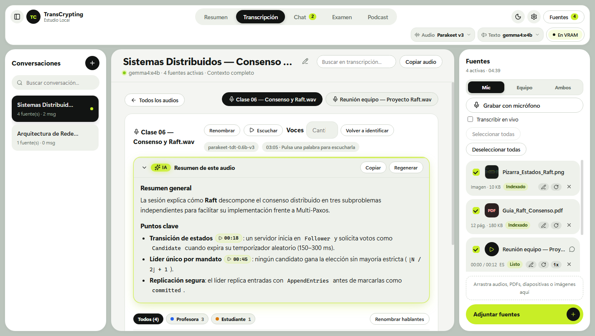
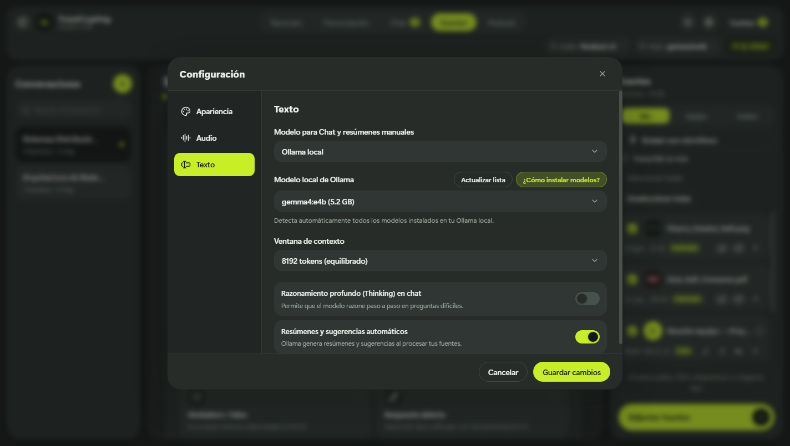

# TransCrypting — Local-First Multi-Source AI Workspace for Lectures, Meetings & Study

**TransCrypting** is a multi-source audio, document, and study workspace designed to run **locally by default** on **Windows (`x64` / `ARM64`)** and **macOS (Apple Silicon)**. Record classes or desktop meetings, transcribe speeches and identify speakers on your own hardware, index PDFs, slides, and whiteboard photos in a persistent local `SQLite FTS5` database, ask source-grounded questions rendered with rich Markdown tables and clickable timestamps, listen to synchronized two-host podcasts, and drill with structured practice exams.

### Focus: Local-First by Default, Flexible by Choice

- **Your audio and files stay on your machine**: microphone & WASAPI system audio capture, Whisper / Parakeet / Canary / Qwen3 / Nemotron speech recognition, speaker diarization (`sherpa-onnx`), PDF/Office/OCR text extraction, `SQLite FTS5` search indexing, and Kokoro-82M / Piper podcast voice synthesis all execute locally with zero cloud dependency.
- **Instant choice of Text engine (`Audio` + `Texto` in the top bar)**: run **100% offline with Ollama** by default (`gemma4:e4b`, `qwen3:8b`, `llama3.2:3b`, `qwen2.5:1.5b`, etc.), or optionally connect **DeepSeek Flash** in **Configuración → Texto** when you want faster/larger cloud reasoning for chat and on-demand summaries while keeping transcription completely local.
- **Modular hardware footprint**: pick only the speech-to-text runtime you need during installation (`setup.bat` profiles `1–4` on Windows or Apple Silicon Metal/MLX on macOS) and manage individual model weights cleanly from Settings.

---

## Screenshots

### 1. Chat-First Workspace, GFM Markdown Tables & Cross-Source Citations (Dark Mode)
Opens directly in **Chat** with top-bar **Audio** & **Texto** model switchers, bulk/single-recording source filtering, GitHub-Flavored Markdown comparison tables, clickable `▶ MM:SS` audio timestamps, and integrated document/image citation pills.


### 2. Per-Recording AI Summary (`✦ IA`) & Interactive Transcript (Light Mode)
Every recording has its own collapsible, luminous **`✦ IA` individual summary** right inside the **Transcripción** tab (auto-generated or created on demand even in Eco Mode), followed by speaker filter pills, speaker count identification/renaming, and word-synced playback.



### 3. Unified General Summary Across Active Sources (`✦ IA`)
Synthesizes active audio recordings, PDFs, presentations, and analyzed images into one highlighted **`✦ IA`** briefing with Markdown tables, clickable timestamp/page pills, and 1-click `.md` export.


### 4. Synchronized Two-Host Podcast Player (`Kokoro-82M ONNX`)
Clean listening deck (`Escuchar` / `+ Nuevo episodio`) with per-host live speaking glow, `-10s` / `+10s` scrubbing, speed control, and a **word-by-word synchronized script** with an active **`✓ Siguiendo texto`** auto-scroll toggle.


### 5. Customizable Exam Studio
Two-column exam builder to pick exact sources and focus topics, question count (`3–15`), format (`Mixto completo`, `Opción múltiple`, balanced `Verdadero / Falso`, `Respuesta abierta`), difficulty, cognitive style, hints, countdown timer, and Real Exam Mode.


### 6. Sectioned Settings (`Apariencia`, `Audio`, `Texto`, `Rendimiento`)
Cleanly grouped preferences with persistent Light / Graphite Dark theme, custom accent color & font scaling, modular ASR model downloads/deletions, Ollama detection, optional DeepSeek Flash API configuration, and Eco / Laptop resource controls.



---

## Key Features

- **Multi-Source Local Context (`SQLite FTS5`)**:
  - Combine **Audio recordings** (`.mp3`, `.wav`, `.m4a`, `.ogg`, `.flac`, `.mp4`, etc.), **Documents** (`.pdf`, `.pptx` slides + speaker notes, `.docx`, `.txt`, `.md`), and **Images** (`.png`, `.jpg`, `.webp`, `.bmp`) inside the same conversation.
  - CPU document extraction (`pypdf`, `python-pptx`, `python-docx`) consumes **0 MB of VRAM**, preserves page/slide locators (`p. 4`, `diap. 2`, `sec. 1`), runs automatic local OCR when PDF text is not selectable, and filters empty/scanned placeholder pages.
  - **Bulk & Focused Source Selection**: use **Seleccionar todas**, **Deseleccionar todas**, or the chat icon on a single recording to ask focused questions against one class/meeting without removing other files from the session.
  - **Source Renaming Synced to Search**: rename any recording or document/image source directly from **Fuentes** or **Transcripción** — updates SQLite and `SQLite FTS5` chunks immediately.
- **Individual & Unified AI Summaries (`✦ IA`)**:
  - Automatic or on-demand individual audio summaries inside **Transcripción** (with clickable `[MM:SS]` moments and speaker attribution), plus unified session summaries in **Resumen** visually highlighted with an accent-matched AI glow and **`✦ IA`** badge.
- **Fast Live & Completed Audio Transcription (`Whisper`, `Parakeet v3`, `Canary 1B v2`, `Qwen3-ASR`, `Nemotron`)**:
  - Live provisional preview while recording (including ~1.5s provisional updates on WebM Nemotron capture), omitting empty silence frames and opening finished transcripts automatically.
  - **Windows `x64` / `ARM64` & macOS Apple Silicon**: choose `setup.bat` runtime profile (`1–4`) on Windows or Metal/MLX on macOS, inspect exact disk install status per model, download/delete weights individually from Settings, or drop custom `CTranslate2` folders into `data/models/whisper/`.
- **Opt-In Desktop & Call Audio Capture (`Mic` / `Equipo` / `Ambos`) + Local Speaker Diarization (`sherpa-onnx`)**:
  - Capture microphone alone, desktop audio (`Equipo` via Windows WASAPI loopback), or call mode (`Ambos`) separating your voice (**`Tú`**) from remote participants.
  - Non-blocking subprocess speaker diarization (`Pyannote Segmentation 3.0` + `NeMo TitaNet Small`) publishes transcripts immediately while identifying speakers in the background, plus on-demand speaker identification (with optional speaker count) and inline speaker renaming synced to FTS5.
- **Synchronized Local Podcast Studio (`Kokoro-82M ONNX`)**:
  - Generates two-host study dialogues (`Conversación`, `Repaso de examen`, `Debate`, `Paso a paso` in Spanish or English) using Ollama exclusively before unloading VRAM and synthesizing speech locally with **Kokoro-82M ONNX** (plus **Piper ONNX** / Windows `System.Speech` fallbacks).
  - Saves exact per-turn timestamps (`start`/`end`) for **live turn and word highlighting**, active host glow, `-10s`/`+10s` transport controls, and toggleable **`Siguiendo texto`** auto-scroll.
- **Rich Markdown Rendering & Reliable Local Exam Generation**:
  - Built-in offline GFM Markdown renderer supporting alignment-aware **tables**, **fenced code blocks** with 1-click copy, task checklists, nested lists, and inline clickable citations (`▶ MM:SS` & `📄 archivo · p. X`).
  - **Exam Studio** enforces Ollama native JSON Schema structured output (`format`), compacts fragmented PDF whitespace to preserve output-token headroom, rebalances `Verdadero / Falso` distributions, and salvages truncated items gracefully.
- **Responsive Studio UI, Universal Force-Stop & Persistent Personalization**:
  - Restores active conversation, tab, and focused recording/document on reload; persists **Light / Graphite Dark** theme across restarts alongside custom **accent color**, **font scale**, and **Eco / Laptop** CPU thread limits.
  - Instant **`■ Detener IA`** control stops streaming chat, summaries, Whisper transcription, speaker analysis, exams, or podcast generation cleanly.

---

## Requirements

- **OS**: **Windows 10 / 11** (`x64` or native `ARM64`) or **macOS** (Apple Silicon for Metal / MLX engines)
- **Python**: **3.11–3.13**
- **Text AI (choose one or switch anytime)**:
  - **Local (default)**: [Ollama](https://ollama.com) running locally with a pulled model (`ollama pull gemma4:e4b`, `ollama pull qwen3:8b`, `ollama pull qwen2.5:1.5b` for Eco/laptops, etc.)
  - **Optional API**: a DeepSeek API key entered under **Configuración → Texto → DeepSeek Flash**
- **ffmpeg** available on system `PATH`
- *(Optional)* NVIDIA CUDA GPU on Windows/Linux for accelerated Whisper (`faster-whisper`), `Qwen3-ASR`, and Ollama inference *(on Windows `ARM64`, CUDA packages and `faster-whisper`/`av` are automatically skipped in `requirements.txt` while `onnx-asr` (`Whisper`, `Parakeet v3`, `Canary 1B`), `sherpa-onnx` diarization, documents, OCR, FTS5 chat, exams, and TTS run natively)*

---

## Quick Setup

### Windows (`x64` CUDA / `ARM64`)

1. Clone the repository and enter the project folder:
   ```powershell
   git clone https://github.com/SalmuleFish/TransCrypting.git
   cd TransCrypting
   ```
2. Run **`setup.bat`** (double-click or run from PowerShell/CMD). It creates `.venv`, lets you choose your **speech-to-text engine profile (`1–4`)** — Lightweight ONNX, Whisper CUDA, Balanced, or Full + Qwen3-ASR PyTorch CUDA — installs `requirements-base.txt` + your selected profile, and compiles **`TransCrypting.exe`** with the `TC` icon. Model weights are downloaded later only when you choose them in Settings.
3. *(Optional for offline Text AI)* Pull an Ollama model:
   ```powershell
   ollama pull gemma4:e4b
   ```

### macOS (Apple Silicon) / Manual `venv`

```bash
git clone https://github.com/SalmuleFish/TransCrypting.git
cd TransCrypting
python3 -m venv .venv
source .venv/bin/activate
pip install -r requirements-base.txt
```

---

## Usage

### Launching the App
- **Windows desktop shortcut**: double-click **`TransCrypting.exe`** (`pythonw.exe` + AppUserModelID taskbar integration).
- **Terminal**:
  - Desktop window (WebView2 / PyWebView): `.\.venv\Scripts\python.exe run.py` (macOS: `python run.py`)
  - Local browser: `.\.venv\Scripts\python.exe run.py --browser`
  - Headless API only: `.\.venv\Scripts\python.exe run.py --headless`

### Managing Models
- **Top bar quick switchers**: change the active **Audio** (ASR engine + CPU/CUDA/Metal device) or **Texto** (`Ollama local` model or `DeepSeek Flash`) directly from the command bar.
- **Settings (`Configuración`)**:
  - **Audio**: download or delete individual local ASR models (`Whisper`, `Parakeet TDT 0.6B v3`, `Canary 1B v2`, `Qwen3-ASR`, `Nemotron`), or place custom CTranslate2 folders inside `data/models/whisper/`.
  - **Texto**: refresh local Ollama models (`¿Cómo instalar modelos?` opens copyable commands) or configure **DeepSeek Flash** (stored locally in `data/.deepseek-api-key`, git-ignored).
  - **Podcast TTS**: **Kokoro-82M ONNX** weights (`kokoro-v1.0.onnx` & `voices-v1.0.bin`) are downloaded once on demand into `data/models/tts/kokoro/`.

---

## Project Structure & Privacy

```text
TransCrypting/
├── backend/                # FastAPI API, WASAPI capture, ONNX diarization, ASR, Ollama, DeepSeek client, FTS5 & Podcast TTS
├── docs/screenshots/       # Showcase screenshots generated from synthetic demo data
├── frontend/               # Offline-ready Studio UI (HTML/CSS/JS + bundled Lucide SVG sprite)
├── launcher/               # C# source compiled into TransCrypting.exe
├── tests/                  # Automated pytest suite (50 tests)
├── data/                   # LOCAL ONLY (ignored by Git; only .gitkeep is tracked)
│   ├── audio/              # Uploaded & captured audio recordings
│   ├── sources/            # Uploaded PDFs, slides, docs & images
│   ├── podcasts/           # Locally generated podcast .wav episodes
│   ├── models/             # Whisper, ASR, ONNX diarization & Kokoro/Piper TTS model caches
│   ├── .deepseek-api-key   # Optional local API key file (git-ignored)
│   └── transcript.db       # SQLite database + FTS5 persistent search index
├── .gitignore              # Excludes data/, .venv/, caches, weights & local executables
├── requirements-base.txt   # Core dependencies without optional heavy ASR runtimes
├── requirements.txt        # Full cross-platform dependency manifest
├── setup.bat               # Windows modular setup (profiles 1–4) & launcher compiler
├── LICENSE                 # Project MIT license + Lucide/Feather icon notices
└── run.py
```

User recordings, uploaded files, generated podcasts, model caches, databases, optional API key files, and `.venv/` remain strictly local and are excluded by `.gitignore`.

The web interface uses [Lucide](https://lucide.dev/guide/) icons bundled locally in [`frontend/lucide.svg`](frontend/lucide.svg) (`<use href="/lucide.svg#icon-name"/>` in HTML or `lucideIcon()` in JS); icon notices are included in [`LICENSE`](LICENSE).
