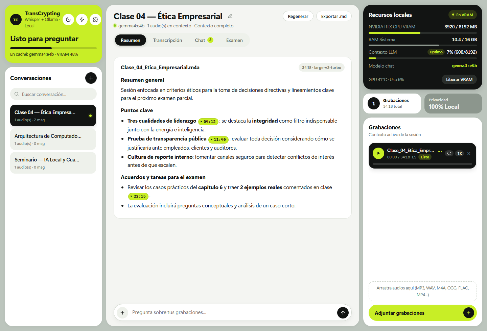
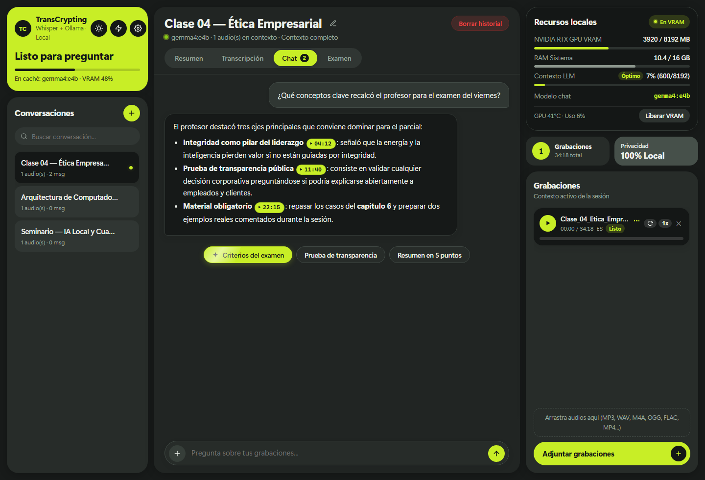
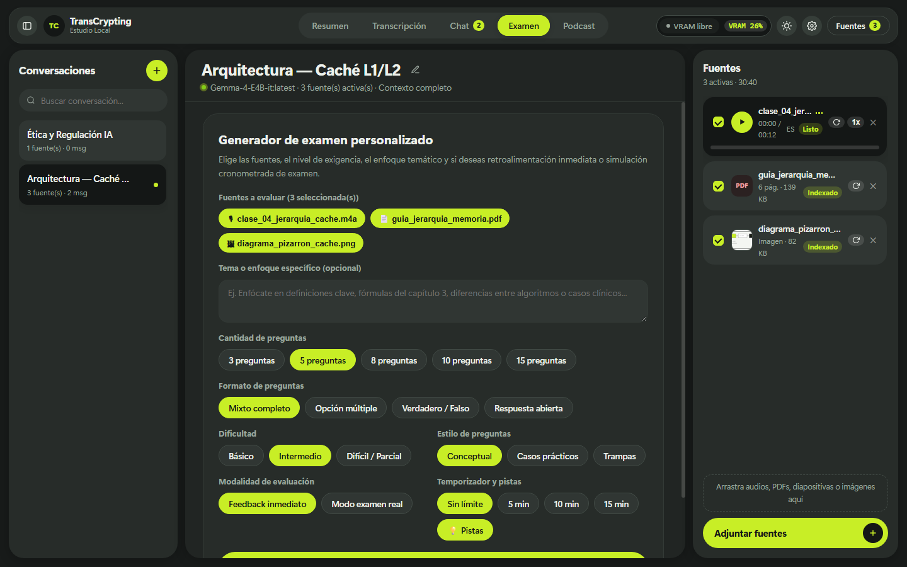
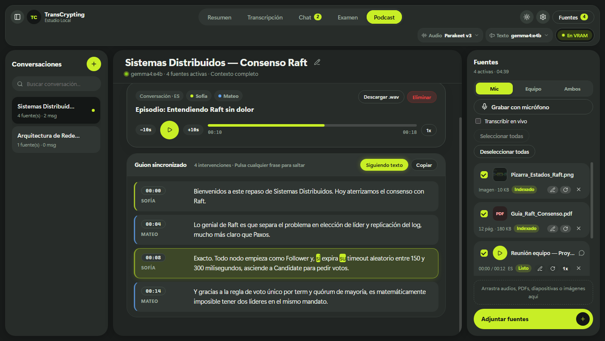
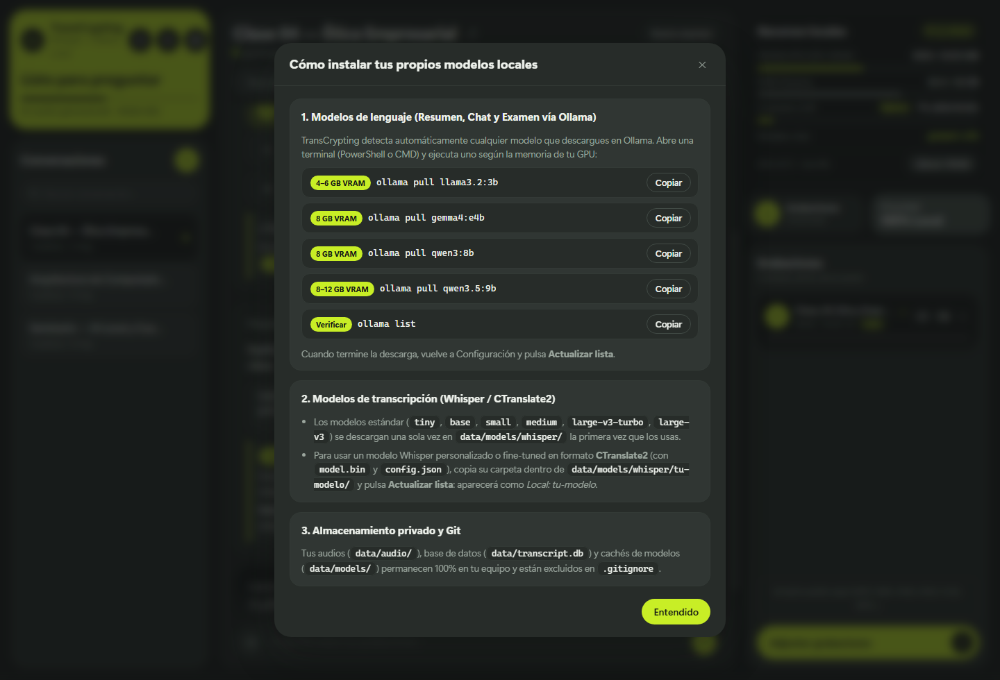

# TransCrypting — Local Multi-Source Study Workspace, Audio Transcription, Podcast Studio & Exam Prep

A desktop study workspace that runs locally by default. Organize courses into notebooks, transcribe lectures, index documents and whiteboard photos, chat with source citations, generate study podcasts, and practice with interactive exams.

---

## Screenshots

### Editorial Studio & Unified General Summary (Light Mode)
Distraction-free top command bar, collapsible Conversations and Sources rails, unified gradient summary across active sources, and clickable `▶ MM:SS` audio & source citations.



### Contextual Chat & Cross-Source Citations (Graphite Dark Mode)
Source-grounded Q&A with clickable timestamp/page/image pills, dynamic AI follow-up suggestions, and an on-demand GPU/RAM/Context telemetry popover in the top bar.



### Customizable Exam Studio
Pick exact sources and topic focus, choose question count (`3–15`), format (`Mixed`, `MCQ`, `True / False`, `Open`), difficulty, question style, hints, countdown timer, and Real Exam Mode.



### 100% Local Podcast Studio (Kokoro-82M ONNX)
Generate two-host study dialogues completely offline with custom focus/style, exclusive resource locking with instant cancellation, audio player, and full episode script.



### Modular Local Models & Built-In Guide
Flexible compatibility with any Ollama LLM, Whisper / CTranslate2 model, and Kokoro-82M / Piper local TTS weights directly from **Settings**.



---

## Key Features

- **Multi-Source Local Context (`SQLite FTS5`)**:
  - Combine **Audio recordings** (`.mp3`, `.wav`, `.m4a`, `.ogg`, `.flac`, `.mp4`, etc.), **Documents** (`.pdf`, `.pptx` slides + speaker notes, `.docx`, `.txt`, `.md`), and **Images** (`.png`, `.jpg`, `.webp`, `.bmp`) inside the same conversation.
  - CPU document extraction (`pypdf`, `python-pptx`, `python-docx`) consumes **0 MB of VRAM**, preserves page/slide locators (`p. 4`, `diap. 2`, `sec. 1`), runs automatic local **Windows CPU OCR** on embedded PDF images when text is not selectable, and rejects unreadable/empty scanned PDFs instead of polluting the index with placeholder pages or wasting LLM calls.
  - **Filename-Aware Retrieval & Source Catalog**: the LLM always receives an explicit catalog of active sources, and queries referencing natural or translated filenames (e.g. `"chapter 11"` or `"capítulo 11"` for `Chapter_11_Persuasive_Messages_Summary.pdf`) automatically boost matching sources even in FTS5 retrieval mode.
  - Images are analyzed **once on upload** using local Ollama vision (or automatic local Windows CPU OCR fallback) and stored in the persistent `SQLite FTS5` index so follow-up chats never reload raw images into VRAM.
  - Every item in the **Sources** panel can be toggled or deleted **instantly** (combined-summary refreshes run asynchronously in the background without blocking UI actions).
- **Universal AI Force-Stop (`■ Detener IA`)**:
  - Stop any active AI generation immediately from anywhere in the workspace: a global **`■ Detener IA`** pill in the top bar plus contextual **`■ Detener`** controls in **Chat** streaming (preserving partial answers), **Summary** regeneration, **Exam** generation & open-answer grading (preserving drafts), **Podcast Studio**, and processing **Source/Recording** cards.
  - Backed by `POST /api/system/stop`, which immediately closes active Ollama streaming sockets (`httpx`), interrupts Whisper transcription between segments, cancels running background pipeline/podcast jobs without stopping the queue worker, and frees resources cleanly.
- **100% Local Podcast Studio (Exclusive Performance Mode)**:
  - Turn selected sources into a two-host **study podcast** (`Conversación`, `Repaso de examen`, `Debate`, or `Paso a paso`, in Spanish or English) with custom topic/focus instructions.
  - Synthesizes expressive speech **100% locally** using **Kokoro-82M ONNX** neural voices (with automatic **Piper ONNX** and Windows `System.Speech` offline fallbacks) and saves replayable `.wav` episodes + full dialogue scripts.
  - **Exclusive Resource Lock & Instant Cancel**: generating a podcast automatically unloads Ollama from VRAM after writing the script before loading TTS voices, locks tab switching/competing AI tasks until finished, and supports instant **Cancel** at any moment.
- **Interactive Cross-Source Citations & Viewer**:
  - `▶ MM:SS` pills jump straight to the exact second of the matching audio recording.
  - `📄 file.pdf · p. 4` and `🖼 image.png` pills open the integrated **Source Viewer** at that exact page, slide, or whiteboard photo.
- **Local Audio Transcription & Modular ASR (`Whisper`, `Parakeet v3`, `Canary 1B v2`, `Qwen3-ASR`)**:
  - Choose which ASR engine runtime to install during `setup.bat` (lightweight ONNX, Whisper CUDA, Balanced, or Full + Qwen3-ASR PyTorch CUDA) instead of downloading everything up front.
  - **Settings** shows exact per-model status (`✓ Descargado en disco` vs `↓ Sin descargar`), letting you explicitly **download or remove individual model weights** on demand (`Parakeet TDT 0.6B v3`, `Canary 1B v2`, `Qwen3-ASR 0.6B/1.7B`, `Whisper`, or custom `CTranslate2` folders).
- **Opt-In Desktop & Call Audio Capture (`Mic` / `Equipo` / `Ambos`) + Speaker Diarization (`sherpa-onnx`)**:
  - Record strictly your microphone by default, or opt into **`Equipo`** (Windows WASAPI loopback with zero screen-share prompts) or **`Ambos`** (call mode with a live VU meter and live preview).
  - **100% Local Speaker Diarization** (`Pyannote Segmentation 3.0 ONNX` + `NeMo TitaNet Small ONNX`): separates uploaded/desktop audio into `Hablante 1`, `Hablante 2`, … and uses synchronized dual-track WAV separation in `Ambos` mode to distinguish **`Tú`** from remote speakers, complete with speaker filter pills and inline renaming synced to FTS5.
- **Interactive Exam Studio**: Studio-grade two-column composer with source tiles, format cards (`Mixto`, `Opción múltiple`, balanced `Verdadero / Falso`, `Respuesta abierta`), difficulty/cognitive style, hints, countdown timer, and Real Exam Mode, backed by Ollama **JSON Schema structured output**, automatic PDF whitespace compaction with reserved output-token headroom, and truncated-JSON recovery.
- **Smart Memory Management**: ASR engines, Ollama, and Podcast TTS take exclusive turns cleanly, with configurable idle VRAM unloading and an instant **Liberar VRAM** button.
- **Eco / Laptop Mode (Optional Battery & Thermal Saver)**:
  - Disabled by default so GPU desktops keep full automatic summaries; when enabled in **Settings**, uploads only index into `SQLite FTS5` (**0 background LLM calls**), images use local CPU OCR, and summaries/suggestions run **on demand**.
  - Includes a configurable **CPU thread cap** (`eco_cpu_threads`), `num_predict`/`repeat_penalty` guardrails, `num_ctx = 4096`, `idle_unload = 60s`, and a live Eco progress bar with elapsed time.
- **Fluid Responsive Studio & Appearance Personalization**: Container-query responsive layouts, slide-over drawers on compact windows, Light & Soft Graphite Dark themes, live **accent color & font size** customization in Settings, per-audio transcript cards with multi-audio timestamp citation matching, native `.md` export, and **Borrar historial**.

---

## Requirements

- **Windows 10 / 11** (`x64` or native `ARM64` such as Snapdragon X)
- **Python 3.11–3.13**
- **Ollama** installed locally ([ollama.com](https://ollama.com)) with at least one local model pulled (e.g., `ollama pull gemma4:e4b`, `ollama pull qwen3:8b`, or `ollama pull qwen2.5:1.5b` for Eco/laptops)
- **ffmpeg** available on system `PATH`
- *(Optional)* NVIDIA CUDA-compatible GPU for accelerated Whisper and Ollama inference *(on `ARM64`, CUDA packages and `faster-whisper`/`av` are automatically skipped in `requirements.txt` while documents, OCR, FTS5 chat, exams, and TTS run natively)*

---

## Quick Setup

1. Clone the repository and enter the project folder:
   ```powershell
   git clone https://github.com/SalmuleFish/TransCrypting.git
   cd TransCrypting
   ```
2. Run **`setup.bat`** (double-click or run from PowerShell/CMD). It creates `.venv`, lets you choose your **speech-to-text engine profile (`1–4`)** — Lightweight ONNX, Whisper CUDA, Balanced, or Full + Qwen3-ASR PyTorch CUDA — installs dependencies (`requirements-base.txt` + selected profile), and compiles **`TransCrypting.exe`** with the `TC` icon. Model weights are never pre-downloaded during setup; you choose inside **Settings**.
3. Pull an Ollama model if you have not yet:
   ```powershell
   ollama pull gemma4:e4b
   ```

---

## Usage

### Launching the App
- Double-click **`TransCrypting.exe`** (uses `pythonw.exe` + Windows AppUserModelID for clean taskbar integration).
- Or run via terminal:
  - Desktop window (WebView2): `.\.venv\Scripts\python.exe run.py`
  - Local browser: `.\.venv\Scripts\python.exe run.py --browser`
  - Headless API only: `.\.venv\Scripts\python.exe run.py --headless`

### Modular Models (Bring Your Own Models)
Open **Configuración → Texto** and click **`¿Cómo instalar modelos?`** for the built-in copyable command guide.
- **Ollama LLMs (Summaries / Chat / Exams / Podcast Scripts)**: pull any model with `ollama pull <model>` (`qwen2.5:1.5b`, `gemma4:e2b`, `llama3.2:3b`, `gemma4:e4b`, `qwen3:8b`, `qwen3.5:9b`, etc.) and click **Actualizar lista**. For image vision analysis, choose a vision-capable model such as `gemma4:e4b` or `gemma4:e2b`.
- **Audio transcription.** New configurations on Apple Silicon use **Nemotron Labs Unified ASR 0.6B** with Spanish selected when MLX Audio is installed. Settings also offers **Qwen3-ASR 0.6B and 1.7B**, **Parakeet TDT 0.6B v3**, and **Whisper** presets. MLX models use the GPU in Automatic mode and download their weights on first use. To add a custom **CTranslate2** model, place its folder in `data/models/whisper/`.
- **Kokoro-82M / Piper TTS Voices (Podcasts)**: **Kokoro-82M ONNX** weights (`kokoro-v1.0.onnx` and `voices-v1.0.bin`) are downloaded once on demand into `data/models/tts/kokoro/` (with Piper fallback in `data/models/tts/`).

### DeepSeek Flash for text

Select **DeepSeek Flash** under **Configuración → Texto**, enter your API key, and save. Chat and on-demand summaries send the required text context to DeepSeek. Audio transcription runs locally with the model selected under **Audio**.

---

## Project Structure & Git Privacy

```text
TransCrypting/
├── backend/                # FastAPI API, WASAPI capture, ONNX diarization, ASR, Ollama, FTS5 & Podcast TTS
├── docs/screenshots/       # README showcase screenshots (demo data only)
├── frontend/               # Responsive Studio UI (HTML/CSS/JS + Lucide icons)
├── launcher/               # C# source compiled into TransCrypting.exe
├── tests/                  # Automated pytest suite
├── data/                   # LOCAL ONLY (ignored by Git; only .gitkeep is tracked)
│   ├── audio/              # Uploaded & captured audio recordings
│   ├── sources/            # Uploaded PDFs, slides, docs & images
│   ├── podcasts/           # Locally generated podcast .wav episodes
│   ├── models/             # Whisper, ASR, ONNX diarization & Kokoro/Piper TTS model caches
│   └── transcript.db       # SQLite database + FTS5 persistent search index
├── .gitignore              # Excludes data/, .venv/, caches, weights & local executables
├── requirements-base.txt   # Core local dependencies (without optional heavy ASR engines)
├── requirements.txt        # Full cross-platform dependency manifest
├── setup.bat               # Windows 1-click modular setup (profile selector 1-4) & launcher compiler
└── run.py
```

User recordings, uploaded files, generated podcasts, model caches, databases, the saved API key, and `.venv/` are stored locally and excluded via `.gitignore`.

The web interface uses [Lucide](https://lucide.dev/guide/) icons bundled in [frontend/lucide.svg](frontend/lucide.svg). Use `<use href="/lucide.svg#icon-name"/>` in HTML or `lucideIcon()` in JavaScript. The icon notices are in [LICENSE](LICENSE).
